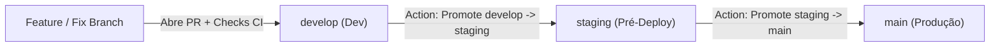

# Portal do Invocador

Site institucional comemorativo e educativo dedicado aos **15 anos de história de League of Legends** (de 2009 aos dias atuais), desenvolvido com foco nos fundamentos da web e estética inspirada no universo **Hextech / Dark Fantasy** de Runeterra.

---

## 🎨 Design & Protótipo (Figma)

Todo o sistema visual, paleta de cores Hextech, tipografia e protótipos de telas estão documentados no Figma e sincronizados com os Design Tokens do projeto:

- **Arquivo no Figma:** [Portal do Invocador — Design System & Telas](https://www.figma.com/design/tflksBAGmcZSgKw2lCCvc1/Portal-do-Invocador?node-id=2-2126&t=P6S6nilkxfllTv2l-0)
- **Design Tokens (W3C DTCG 2025.10 / Tokens Studio):** [`figma/tokens.json`](./figma/tokens.json)
- **Definição de Tema (Veritheme):** [`figma/theme.json`](./figma/theme.json)
- **Guia de Construção no Figma:** [`figma/FIGMA_GUIDE.md`](./figma/FIGMA_GUIDE.md)

---

## 🌐 Ambientes e Fluxo de Branches (Vercel)

O projeto utiliza um fluxo estruturado de promoção contínua entre três ambientes permanentes na **Vercel**, além de ambientes temporários de Preview por Pull Request:

| Ambiente | Branch | URL (Vercel) | Finalidade |
| :--- | :--- | :--- | :--- |
| **Produção** | `main` | [https://portal-do-invocador.vercel.app/](https://portal-do-invocador.vercel.app/) | Código principal e estável em produção |
| **Pré-Deploy (Staging)** | `staging` | [https://staging-portal-do-invocador.vercel.app/](https://staging-portal-do-invocador.vercel.app/) | Homologação e validação pré-release |
| **Desenvolvimento** | `develop` | [https://develop-portal-do-invocador.vercel.app/](https://develop-portal-do-invocador.vercel.app/) | Integração contínua de novas funcionalidades |
| **Preview de PR** | `feature/*` / `fix/*` | *Gerado sob demanda via `@deploy-pr`* | Ambiente temporário exclusivo para testar a PR antes do merge |

---

## 🛠️ Tecnologias Utilizadas

- **HTML5 Semântico:** Arquitetura Multi-Page Application (MPA) com páginas independentes e acessíveis.
- **CSS3 Modular & Design Tokens:** Estilização customizada com variáveis CSS (Custom Properties), layout responsivo (Grid/Flexbox) e estética Hextech.
- **JavaScript (Vanilla ES6+):** Manipulação de DOM sem frameworks externos, consumo assíncrono de dados (`fetch`), filtros dinâmicos, carrossel interativo, validação de formulários e FAQ acessível (`aria-expanded`).
- **Vite 6:** Servidor de desenvolvimento com Hot Module Replacement (HMR) e empacotador para build de produção Multi-Page.
- **ESLint, Husky & SonarCloud:** Padronização de código com Git Hook `pre-commit` (que executa `npm run lint` automaticamente em todo `git commit`) e análise estática contínua de qualidade e segurança no SonarCloud.

---

## 🚀 Como Iniciar o Ambiente de Desenvolvimento

### Pré-requisitos

- [Node.js](https://nodejs.org/) (versão 20 ou superior recomendada)
- Gerenciador de pacotes `npm` (incluído com o Node.js)

### Passo a Passo

1. **Clone o repositório:**
   ```bash
   git clone https://github.com/KenjiWorkES/portal-do-invocador.git
   cd portal-do-invocador
   ```

2. **Instale as dependências (configura automaticamente o Git Hook do Husky):**
   ```bash
   npm install
   ```

3. **Inicie o servidor de desenvolvimento:**
   ```bash
   npm run dev
   ```
   O servidor abrirá automaticamente no navegador (por padrão em `http://localhost:5173/src/pages/index.html`). Qualquer acesso à raiz `/` é redirecionado automaticamente para `/src/pages/index.html`.

### Scripts Disponíveis

| Comando | Descrição |
| :--- | :--- |
| `npm run dev` | Inicia o servidor local de desenvolvimento com HMR |
| `npm run lint` | Executa o ESLint em todos os arquivos JavaScript (`src/js/`) |
| `npm run build` | Compila e minifica as páginas e assets de produção na pasta `dist/` |
| `npm run preview` | Inicia um servidor local para inspecionar o build de produção |

---

## 🔀 Como Criar uma Pull Request (PR)

Todas as entregas são rastreadas pelo quadro do [GitHub Project — Portal do Invocador](https://github.com/users/KenjiWorkES/projects/3) e possuem regras de validação automática para proteger as branches `develop`, `staging` e `main`.

### 1. Crie sua branch a partir de `develop`
```bash
git checkout develop
git pull origin develop
git checkout -b feature/pixp-0000-nome-da-task
```
*(Use prefixos semânticos como `feature/`, `fix/`, `docs/` ou `refactor/`).*

### 2. Faça o commit (Validação Automática de Lint no `pre-commit`)
Sempre que você executar `git commit`, o **Husky** rodará automaticamente o comando `npm run lint` (configurado em [`.husky/pre-commit`](./.husky/pre-commit)):
- Se houver qualquer erro de sintaxe ou regra do ESLint, **o commit será bloqueado automaticamente** até que o problema seja corrigido.
- Antes de fazer o `push`, recomenda-se também validar o empacotamento:
  ```bash
  npm run build
  ```

### 3. Abra a Pull Request apontando para `develop`
Ao abrir a PR no GitHub, siga obrigatoriamente os **3 requisitos de governança**:

1. **Título no padrão da Task (`PIXP-0000: Nome da Task`):**
   - O título **deve** começar com `PIXP-` seguido de **4 dígitos numéricos**, dois-pontos, espaço e a descrição da entrega.
   - ✅ Exemplo válido: `PIXP-0008: Criar Seção Bento Grid o Universo Expandido de Runeterra`
   - ❌ Exemplo inválido: `Criando seção bento grid na home`
2. **Adicione pelo menos 1 Label (Tag) obrigatória na lateral direita da PR:**
   - `feature` — Novas páginas, seções ou funcionalidades
   - `fix` — Correção de bugs visuais, lógicos ou de responsividade
   - `docs` — Alterações de documentação (`README.md`, guias, comentários)
   - `refactor` — Melhorias técnicas de código sem alterar comportamento externo
3. **Preencha o Template da PR (`.github/pull_request_template.md`):**
   - Descreva de forma objetiva o que foi desenvolvido/corrigido e inclua o link da Task correspondente no GitHub Project.

### 4. Gere o Deploy Temporário comentando `@deploy-pr`
Toda PR inicia com o check obrigatório **`Deploy PR Preview`** pendente:
1. Vá até a caixa de comentários da sua Pull Request.
2. Envie um comentário contendo exatamente:
   ```text
   @deploy-pr
   ```
3. A GitHub Action reagirá com um 🚀, fará o build e deploy temporário na Vercel, responderá na PR com a **URL de Preview** para testes e marcará o check **`Deploy PR Preview`** como concluído (`✅`).
4. *(Importante: se você enviar novos commits para a branch da PR, o check volta a ficar pendente até que um novo `@deploy-pr` seja executado).*

### 5. Code Review e Merge
- Toda PR exige **1 aprovação (Approve)** e todos os **5 checks obrigatórios verdes** antes de liberar o botão de Merge.
- Desenvolvedores devem solicitar revisão na aba **Files changed → Review changes**.
- O mantenedor do repositório (`@KenjiWorkES`) pode aprovar PRs rapidamente comentando `@approve` na conversa da PR.

---

## ⚙️ Pipeline de CI/CD (GitHub Actions, SonarCloud & Vercel)

O projeto conta com **6 workflows automatizados** em [`.github/workflows/`](./.github/workflows) que garantem qualidade de código, padronização e entrega contínua:



### Detalhamento dos Workflows

| Workflow | Arquivo | Gatilho | O que faz |
| :--- | :--- | :--- | :--- |
| **CI — Lint, Build & Code Quality** | [`ci.yml`](./.github/workflows/ci.yml) | `push` e `pull_request` em `develop`, `staging`, `main` | Executa **Lint** (`npm run lint`), **Build** (`npm run build`) e análise estática no **SonarCloud Code Quality** (bugs, vulnerabilidades e code smells). |
| **PR Validation — Title & Labels** | [`pr-validation.yml`](./.github/workflows/pr-validation.yml) | Abertura, edição, novo commit ou mudança de label na PR | Valida o formato do título (`^PIXP-\d{4}: \S+`), exige ao menos uma label (`feature`, `fix`, `docs`, `refactor`) e inicializa o check `Deploy PR Preview` como pendente. |
| **Deploy PR Preview** | [`deploy-pr.yml`](./.github/workflows/deploy-pr.yml) | Comentário `@deploy-pr` em uma PR aberta | Faz o deploy isolado da branch da PR na Vercel CLI, comenta o link temporário de Preview na PR e conclui o check `Deploy PR Preview` (`✅`). |
| **PR Self-Approval** | [`pr-review.yml`](./.github/workflows/pr-review.yml) | Comentário `@approve` em uma PR aberta | Permite aprovação rápida via comentário exclusivamente para o mantenedor (`@KenjiWorkES`), bloqueando auto-aprovação por outros usuários. |
| **Promote (`develop` → `staging`)** | [`promote-develop-to-staging.yml`](./.github/workflows/promote-develop-to-staging.yml) | Manual (`workflow_dispatch` na aba Actions) | Valida `lint` e `build` da branch `develop` e abre/atualiza automaticamente a PR padronizada de promoção para `staging`. |
| **Promote (`staging` → `main`)** | [`promote-staging-to-main.yml`](./.github/workflows/promote-staging-to-main.yml) | Manual (`workflow_dispatch` na aba Actions) | Valida `lint` e `build` da branch `staging` e abre/atualiza automaticamente a PR padronizada de release para `main` (Produção). |

### Status Checks Obrigatórios (Branch Protection)
Nenhuma PR pode ser mesclada em `develop`, `staging` ou `main` sem que todos os 5 checks abaixo estejam aprovados (`✅`):
1. **`Validate PR`** — Título `PIXP-0000: ...` e label obrigatória validados
2. **`Lint`** — Código JavaScript validado pelo ESLint sem erros
3. **`Build`** — Empacotamento de produção do Vite concluído com sucesso
4. **`SonarCloud Code Quality`** — Quality Gate aprovado no SonarCloud
5. **`Deploy PR Preview`** — Ambiente de Preview gerado via comando `@deploy-pr`

---

## 📁 Estrutura de Pastas

```text
portal-do-invocador/
├── .github/                      # Templates de PR e Workflows de CI/CD (GitHub Actions)
│   ├── workflows/
│   │   ├── ci.yml
│   │   ├── deploy-pr.yml
│   │   ├── pr-review.yml
│   │   ├── pr-validation.yml
│   │   ├── promote-develop-to-staging.yml
│   │   └── promote-staging-to-main.yml
│   └── pull_request_template.md
│
├── .husky/                       # Git Hooks (validação automática de lint antes do commit)
│   └── pre-commit                # Executa `npm run lint` em todo `git commit`
│
├── public/                       # Arquivos estáticos servidos diretamente na raiz
│   └── data/
│       └── champions.json        # Base de dados JSON com catálogo de campeões
│
├── src/                          # Código-fonte principal da aplicação
│   ├── css/
│   │   ├── main.css              # Ponto de entrada CSS (importa módulos na ordem da cascata)
│   │   ├── variables.css         # Design Tokens e Custom Properties Hextech
│   │   ├── base.css              # Reset universal, tipografia base e containers
│   │   ├── layout.css            # Header, navegação principal e footer institucional
│   │   ├── components.css        # Estilos de componentes e seções das páginas
│   │   └── responsive.css        # Media queries para Desktop, Tablet e Mobile
│   ├── js/
│   │   ├── carousel.js           # Lógica de transição, autoplay e controles do Hero Carousel
│   │   ├── champions.js          # Fetch de champions.json, busca, filtros e modal de detalhes
│   │   ├── contact.js            # Validação de formulário em tempo real, contador e toast
│   │   ├── faq.js                # Comportamento de acordeão acessível no FAQ
│   │   └── nav.js                # Controle do menu mobile e botão Voltar ao Topo
│   └── pages/
│       ├── index.html            # Página Inicial (Home)
│       ├── timeline.html         # Linha do Tempo (2009 ao presente)
│       ├── regions.html          # Regiões de Runeterra e Conflitos Históricos
│       ├── champions.html        # Catálogo Interativo de Campeões
│       ├── modes.html            # Modos de Jogo e Guia de Rotas
│       ├── contact.html          # Suporte ao Invocador, Status de Servidores e FAQ
│       └── 404.html              # Página de Erro 404 Personalizada
│
├── figma/                        # Recursos e especificações de Design System
│   ├── FIGMA_GUIDE.md            # Guia de importação de tokens e construção no Figma
│   ├── canvas-preview.html       # Visualizador interativo de tokens e componentes
│   ├── theme.json                # Definições de tema visual (Veritheme)
│   └── tokens.json               # Design Tokens no padrão W3C DTCG 2025.10 / Tokens Studio
│
├── CONTEXT.md                    # Contexto geral e objetivos pedagógicos do projeto
├── DESIGN.md                     # Documentação do Design System Hextech
├── PRODUCT.md                    # Especificação de produto
├── eslint.config.js              # Regras de linting JavaScript (ESLint 9 Flat Config)
├── sonar-project.properties      # Configuração de análise de qualidade do SonarCloud
├── vercel.json                   # Redirecionamentos e rotas da Vercel
├── vite.config.js                # Configuração Multi-Page Application (MPA) do Vite
└── package.json                  # Dependências e scripts npm
```
